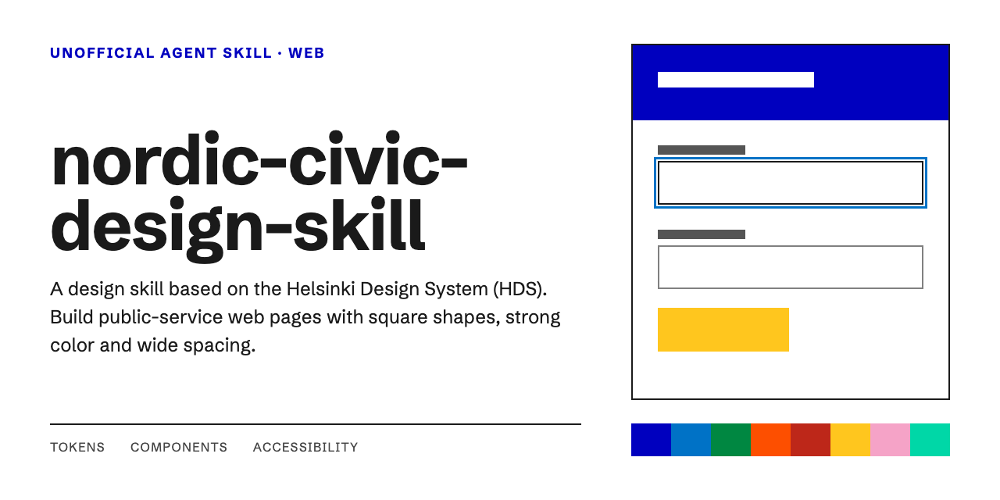
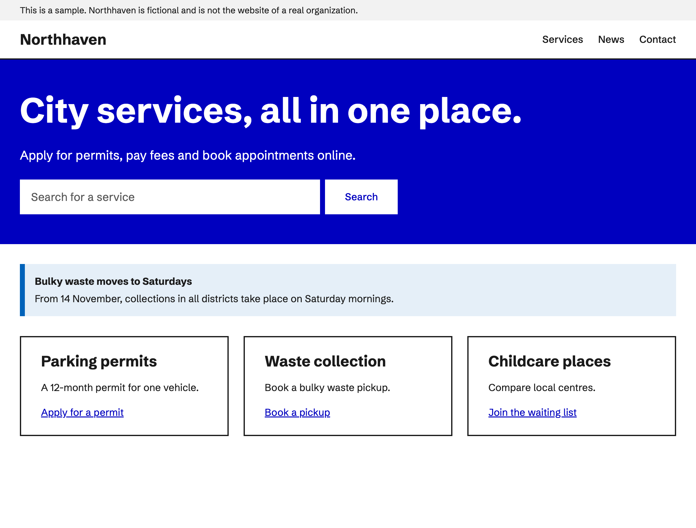
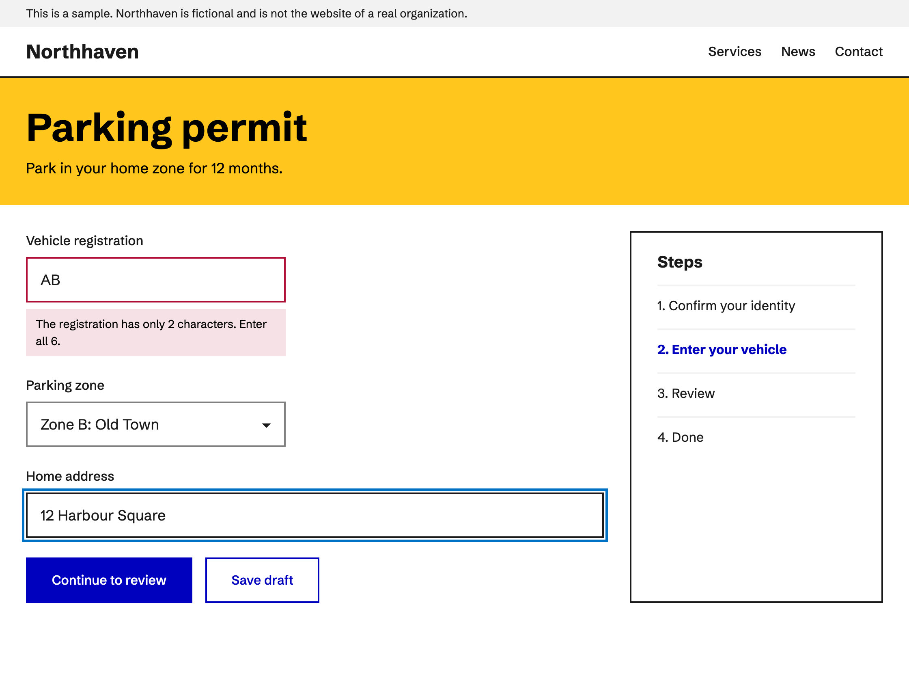
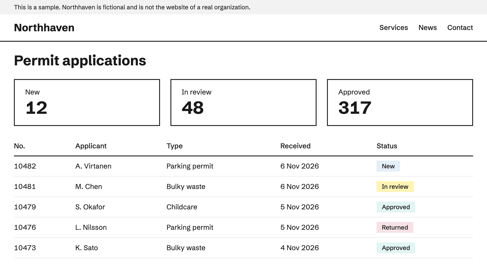

# nordic-civic-design-skill

[日本語](README.md) | English



A design skill for AI agents based on the [Helsinki Design System](https://hds.hel.fi/) (HDS). It designs, builds, and reviews public-service web pages with square shapes, strong colors, and wide spacing. It is written for Claude Code and Codex.

> [!NOTE]
> This skill is unofficial. It was not created or endorsed by the City of Helsinki. Do not use it to imitate the City's official sites.

## What it does

- Builds pages from the HDS color, spacing, and type tokens.
- Builds buttons, input fields, checkboxes, notifications, cards, and links from HDS values.
- Checks focus indicators, control sizes, and contrast.
- Uses Schibsted Grotesk as the default typeface, and Noto Sans JP for Japanese text.

This skill is for websites only. It is not for native apps such as iOS apps.

The bundled documentation is in Japanese.

## What it leaves out

| Item | Reason |
| --- | --- |
| Helsinki logo and coat of arms | The logo is a registered trademark and may not be recreated or modified |
| Wave motif | It identifies the City, and its terms for third parties are unconfirmed |
| Helsinki Grotesk font files | Commercial font from Camelot Typefaces. Redistribution is prohibited |

## Examples

These sample screens were made with the values in this skill. The city and the data are fictional.

**Public website:** a home page with a strong color area, a search box, a notice, and link cards.



**Application form:** an input error, and a 3px blue focus outline.



**Admin screen:** summary cards and a data table with status labels.



## Installation

Clone the repository into your agent's skills folder.

Claude Code:

```bash
git clone https://github.com/capsrock/nordic-civic-design-skill.git ~/.claude/skills/nordic-civic-design-skill
```

Codex:

```bash
git clone https://github.com/capsrock/nordic-civic-design-skill.git ~/.agents/skills/nordic-civic-design-skill
```

## Usage

Ask your agent something like this, and the skill will be applied.

- "Build a resident service page in a Nordic public-sector style."
- "Build an application form that looks like an HDS site."
- "Review this page against nordic-civic-design-skill."

You can also call it by name.

Claude Code:

```text
/nordic-civic-design-skill Build a web form for a parking permit application
```

Codex:

```text
$nordic-civic-design-skill Build a web form for a parking permit application
```

## Setting the design

### Tokens

Colors, spacing, and type sizes are CSS variables in `references/tokens.css`. Use the variables rather than writing values directly.

```html
<link rel="stylesheet" href="tokens.css">
<link rel="stylesheet" href="app.css">
```

```css
body {
  color: var(--color-black-90);
  font-size: var(--fontsize-body-m);
}

.button-primary {
  background: var(--color-bus);
  color: var(--color-white);
  padding: var(--spacing-s) var(--spacing-l);
}
```

`tokens.css` is under the MIT License. The file itself contains no copyright notice, so when you distribute it, include [references/LICENSE-HDS.txt](references/LICENSE-HDS.txt).

### Typeface

```css
font-family: HelsinkiGroteskPro, "Schibsted Grotesk", Arial, "Noto Sans JP", sans-serif;
```

People with a Helsinki Grotesk license see that typeface. Everyone else sees Schibsted Grotesk. The choice of Schibsted Grotesk and Noto Sans JP belongs to this skill. It is not an HDS rule.

### Shape rules

| Item | Value |
| --- | --- |
| Corner radius | 0 |
| Borders on buttons, inputs, and cards | 2px |
| Standard control height | 56px |
| Small button height | 44px |
| Notification | 8px bar on the left with a light background |
| Focus indicator | 3px outline in `--color-coat-of-arms` |

## Structure

```text
nordic-civic-design-skill/
├── SKILL.md                The skill itself
├── README.md               Japanese README
├── README.en.md            This file
├── LICENSE                 License for the original work
├── assets/
│   ├── social-card-jp.png  Social card (Japanese)
│   ├── social-card-en.png  Social card (English)
│   ├── jp/                 Sample images (Japanese)
│   └── en/                 Sample images (English)
└── references/
    ├── tokens.css          HDS design tokens
    ├── components.md       Component values and usage
    ├── foundation.md       Colour, type, spacing and shadow values and usage
    └── LICENSE-HDS.txt     HDS license text
```

## Bundled versions

| Content | Version |
| --- | --- |
| Design tokens | `hds-design-tokens` 6.0.7 |
| Component values | `hds-core` 6.0.7 |

These are not updated automatically.

## Sources and license

This skill uses the following, and each stays under the terms listed here. When you use them, follow the license terms, including keeping the copyright notice.

- Design tokens: [City-of-Helsinki/helsinki-design-system](https://github.com/City-of-Helsinki/helsinki-design-system), MIT License, Copyright (c) 2023 City of Helsinki. `references/tokens.css` contains `lib/all.css` from `hds-design-tokens` 6.0.7 without changes. The license text is in [references/LICENSE-HDS.txt](references/LICENSE-HDS.txt).
- Component and foundation values: `references/components.md` summarizes values from `hds-core` 6.0.7, and `references/foundation.md` summarizes the HDS documentation, under the same license.
- Typefaces: Schibsted Grotesk and Noto Sans JP are loaded from Google Fonts and are not bundled. Schibsted Grotesk is under the SIL Open Font License 1.1.

Apart from the files under `references/` and the parts that derive from the Helsinki Design System, `SKILL.md`, `README.md`, `README.en.md`, and `assets/` are under the [MIT License](LICENSE). They were created based on the [Helsinki Design System](https://hds.hel.fi/) by capsrock.
