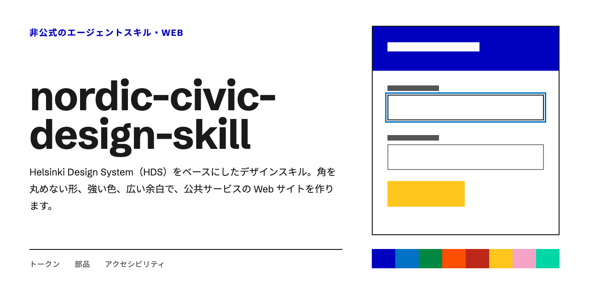
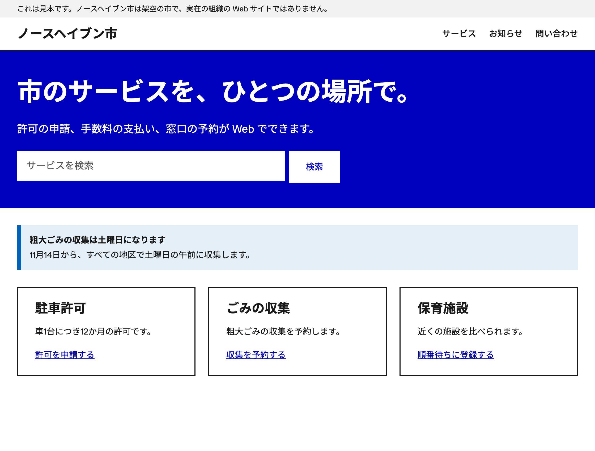
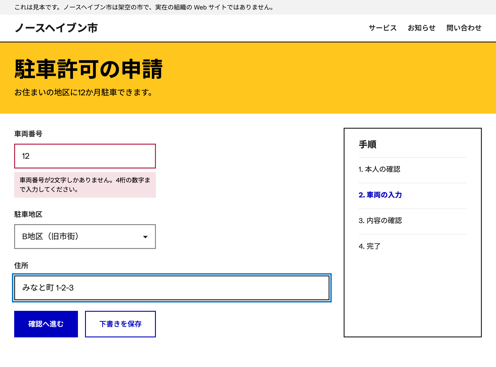
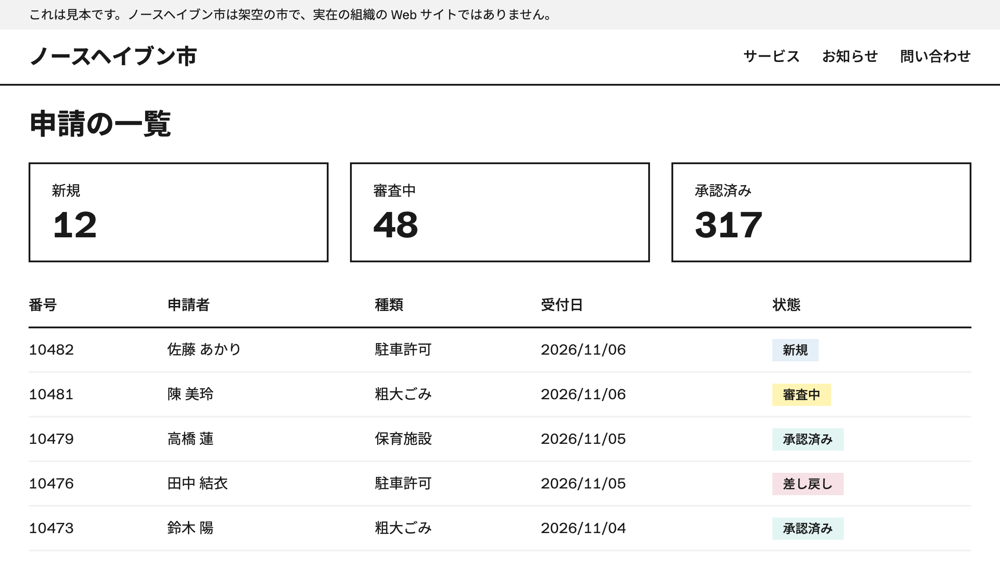

# nordic-civic-design-skill

日本語 | [English](README.en.md)



[Helsinki Design System](https://hds.hel.fi/)（HDS）をベースにした、AI エージェント用のデザインスキルです。角を丸めない形、強い色、広い余白で、公共サービスの Web サイトを設計・実装・見直しします。Claude Code と Codex 向けに書いています。

> [!NOTE]
> このスキルは非公式です。ヘルシンキ市が作成・承認したものではありません。市の公式サイトをまねる目的には使わないでください。

## できること

- HDS の色、余白、文字のトークンを使って画面を作成します。
- ボタン、入力欄、チェックボックス、通知、カード、リンクを HDS の値で作成します。
- フォーカスの表示、操作部品の大きさ、コントラストを確認します。
- 既定の書体は Schibsted Grotesk です。日本語には Noto Sans JP を使います。

Web サイト専用です。iOS などのネイティブアプリには使用しません。

## 含めていないもの

| 項目 | 理由 |
| --- | --- |
| ヘルシンキ市のロゴと市章 | ロゴは登録商標で、作り直しも改変も認められていません |
| 波のモチーフ | 市を識別する要素で、第三者の利用条件を確認できていません |
| Helsinki Grotesk のフォントファイル | Camelot Typefaces の商用書体で、再配布が禁じられています |

## 見本

このスキルの値で作成した画面の見本です。市の名前やデータは架空のものです。

**公共向けのサイト:** 強い色の見出し、検索、お知らせ、リンクのカードを使ったトップページです。



**申請フォーム:** 入力エラーの表示と、3px の青い線で示すフォーカスです。



**管理画面:** 件数のカードと、状態を示すラベルが付いたデータテーブルです。



## インストール

使うエージェントのスキルのフォルダに入れます。

Claude Code:

```bash
git clone https://github.com/capsrock/nordic-civic-design-skill.git ~/.claude/skills/nordic-civic-design-skill
```

Codex:

```bash
git clone https://github.com/capsrock/nordic-civic-design-skill.git ~/.agents/skills/nordic-civic-design-skill
```

## 使い方

エージェントに次のように依頼すると、スキルが適用されます。

- 「北欧の行政サイト風に、市民向けのサービス画面を作って」
- 「HDS 風の申請フォームを作って」
- 「nordic-civic-design-skill に合わせてこの画面を見直して」

名前を指定して呼び出すこともできます。

Claude Code:

```text
/nordic-civic-design-skill 駐車許可の申請フォームの Web 画面を作る
```

Codex:

```text
$nordic-civic-design-skill 駐車許可の申請フォームの Web 画面を作る
```

## デザインの設定

### トークン

色、余白、文字サイズは `references/tokens.css` の CSS 変数で指定します。値を直接書かず、変数を使います。

```html
<link rel="stylesheet" href="tokens.css">
<link rel="stylesheet" href="app.css">
```

```css
body {
  color: var(--color-black-90);
  font-size: var(--fontsize-body-m);
}

.button-primary {
  background: var(--color-bus);
  color: var(--color-white);
  padding: var(--spacing-s) var(--spacing-l);
}
```

`tokens.css` は MIT License です。ファイル本文に著作権表示がないので、配布するときは [references/LICENSE-HDS.txt](references/LICENSE-HDS.txt) を添えてください。

### 書体

```css
font-family: HelsinkiGroteskPro, "Schibsted Grotesk", Arial, "Noto Sans JP", sans-serif;
```

Helsinki Grotesk のライセンスを持つ人の環境ではその書体で表示され、それ以外では Schibsted Grotesk で表示されます。Schibsted Grotesk と Noto Sans JP の採用はこのスキルの判断で、HDS の指定ではありません。

### 形の基準

| 項目 | 値 |
| --- | --- |
| 角丸 | 0 |
| ボタン、入力欄、カードの枠線 | 2px |
| 操作部品の標準の高さ | 56px |
| 小さいボタンの高さ | 44px |
| 通知 | 左に 8px の帯と薄い背景 |
| フォーカスの表示 | `--color-coat-of-arms` の 3px の輪郭線 |

## 構成

```text
nordic-civic-design-skill/
├── SKILL.md                スキル本体
├── README.md               このファイル
├── README.en.md            英語の README
├── LICENSE                 自作部分のライセンス
├── assets/
│   ├── social-card-jp.png  ソーシャルカード（日本語）
│   ├── social-card-en.png  ソーシャルカード（英語）
│   ├── jp/                 見本の画像（日本語）
│   └── en/                 見本の画像（英語）
└── references/
    ├── tokens.css          HDS のデザイントークン
    ├── components.md       部品の値と使いどころ
    ├── foundation.md       色・文字・余白・影の値と使いどころ
    └── LICENSE-HDS.txt     HDS のライセンス文
```

## 同梱している版

| 内容 | 版 |
| --- | --- |
| デザイントークン | `hds-design-tokens` 6.0.7 |
| 部品の値 | `hds-core` 6.0.7 |

自動では更新されません。

## 出典とライセンス

このスキルは次のものを使用しています。それぞれ下記の条件に従います。使うときは、著作権表示を残すなど、ライセンスの条件を守ってください。

- デザイントークン: [City-of-Helsinki/helsinki-design-system](https://github.com/City-of-Helsinki/helsinki-design-system)、MIT License、Copyright (c) 2023 City of Helsinki。`references/tokens.css` は `hds-design-tokens` 6.0.7 の `lib/all.css` を変更せずに収録しています。ライセンス文は [references/LICENSE-HDS.txt](references/LICENSE-HDS.txt) にあります。
- 部品と基礎の値: `references/components.md` は `hds-core` 6.0.7 の値を、`references/foundation.md` は HDS の公式文書の内容をまとめたもので、同じライセンスに従います。
- 書体: Schibsted Grotesk と Noto Sans JP は Google Fonts から読み込み、同梱していません。Schibsted Grotesk は SIL Open Font License 1.1 です。

`references/` の中のファイルと、Helsinki Design System に由来する部分を除き、`SKILL.md`、`README.md`、`README.en.md`、`assets/` は [MIT License](LICENSE) です。[Helsinki Design System](https://hds.hel.fi/) をもとに capsrock が作成しました。
